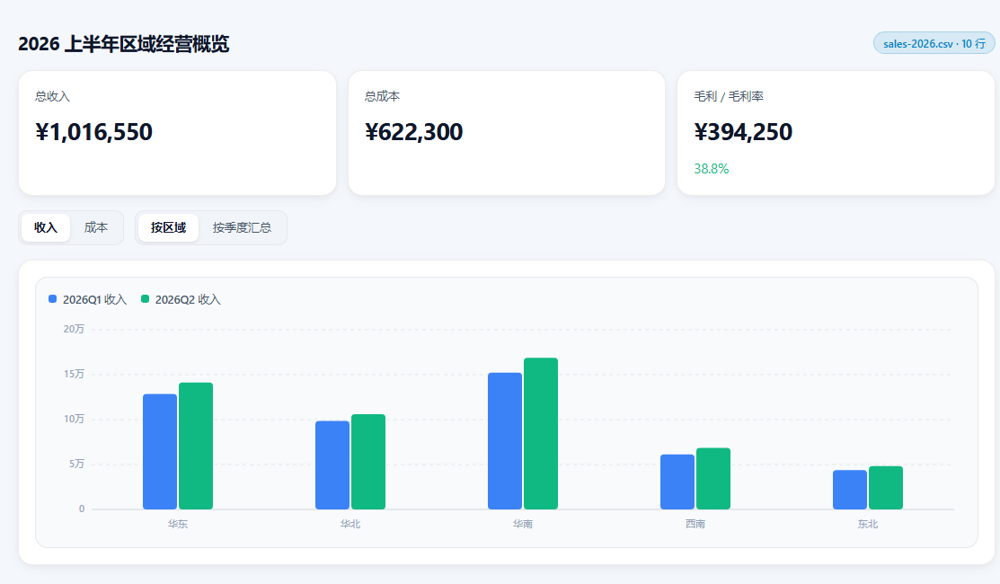
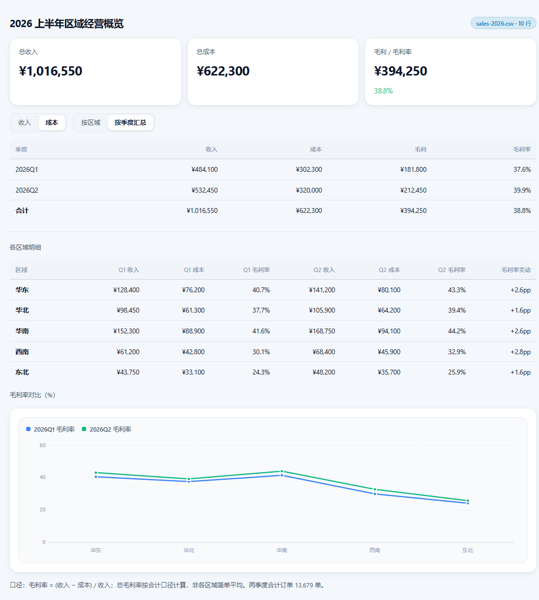
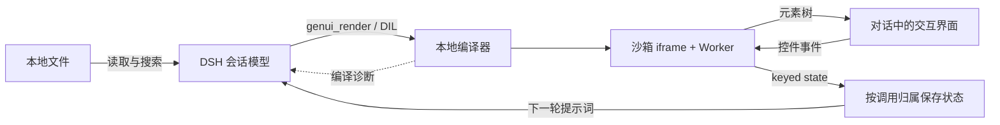

<div align="center">

# DSH GenUI

**让模型把答案变成可以直接操作的界面。**

DeepSeek Harness 的智能界面模式插件 · 读取真实文件 · 交互状态回环

[](package.json)
[](package.json)
[](package.json)
[](LICENSE)

[效果展示](#效果展示) · [快速开始](#快速开始) · [使用示例](#使用示例) · [工作原理](#工作原理) · [常见问题](#常见问题)

</div>

<picture>
  <source media="(prefers-color-scheme: dark)" srcset="docs/images/dashboard-dark.png">
  <source media="(prefers-color-scheme: light)" srcset="docs/images/dashboard-light.png">
  
</picture>

<p align="center"><sub>真实模型根据 CSV 生成的 DIL，由本项目编译器与浏览器运行时渲染。上图展示界面局部，随浅色/深色偏好切换；并非 DSH 会话窗口截图。</sub></p>

## 这是什么

DSH GenUI 为 [DeepSeek Harness](https://github.com/deepseek-ai/deepseek-harness) 增加一个「智能界面模式」。你描述需求，模型调用 `genui_render` 生成计算器、表单、对比表或仪表盘，界面直接出现在对话中。

用户可以在界面里切换选项、调整参数。控件通过本地运行时更新结果，状态会保存并进入下一轮对话；需要模型进一步处理时，继续发送消息即可。

生成能力来自 **DSH 当前会话使用的模型**。编译器与界面运行时随插件本地提供，无需连接 OpenAI 或 ChatGPT。模型请求仍通过你在 DSH 中配置的提供方发送。

## 能做什么

| 能力 | 使用体验 |
|---|---|
| **直接生成界面** | 用自然语言得到带控件的答案，无需手工搭建前端 |
| **读取真实文件** | 用 `read`、`glob`、`grep` 获取内容，再生成基于数据的界面 |
| **图片读取** | `read_image` 复用 DSH 的附件与模型能力检查 |
| **增量渲染** | 支持解析正在传输的工具参数，逐步编译界面；实际效果取决于模型和中转是否流式下发参数 |
| **交互与恢复** | 控件状态按会话和调用隔离保存，重新挂载时尝试恢复；下一轮对话可读取当前状态 |
| **完整展开** | 卡片高度随内容增长或收缩，GenUI 所在工具组取消独立纵向滚动和渐隐 |
| **主题适配** | 提供浅色、深色样式，支持焦点态和减少动画偏好 |
| **只读工具面** | 提供文件读取与搜索；写入、编辑被屏蔽并由 guard 拒绝，不装配 shell 或联网工具 |

> [!NOTE]
> 纯知识问答、闲聊和解释性回答仍使用文字。模式在需要选择、调参、比较、填表、算账或查看图表时生成界面。

## 效果展示

下面这份经营仪表盘来自一次真实模型会话：先读取十行 CSV，再生成界面；首次编译存在诊断，模型修正后成功编译。汇总金额来自读取的数据计算。

| 总收入 | 总成本 | 毛利 | 毛利率 |
|---:|---:|---:|---:|
| ¥1,016,550 | ¥622,300 | ¥394,250 | 38.8% |

切换「收入 / 成本」或「按区域 / 按季度汇总」，同一张界面会更新图表和汇总视图：



<details>
<summary>截图来源与验证范围</summary>

- 源码是模型实际生成的 [`real-sales-interface.dil`](tools/real-sales-interface.dil)，不是手工绘制的 UI 示意图。
- 截图由无头 Edge 加载真实编译器、iframe、Worker 和渲染器后直接截取；没有操作用户 GUI。
- 汇总数字与控件状态回传经过断言检查；截图不代表已在所有 DSH 版本或模型上验证。
- 可运行 [`capture-readme-screenshots.mjs`](tools/capture-readme-screenshots.mjs) 重现图片；详见[开发说明](docs/架构与开发.md#生成文档截图)。
- 真实会话验证使用本地测试副本；本仓库对外安装的模式 ID 为 `genui`。个人会话日志和本机配置不随仓库发布。

</details>

## 快速开始

### 1. 确认环境

| 项目 | 要求 |
|---|---|
| 宿主 | DSH ≥ `0.1.7-rc.2` |
| Node.js | ≥ `20`；浏览器回归与截图脚本使用 Node ≥ `22` 的全局 WebSocket |
| 模型 | 能调用工具、输出完整 DIL 文档；读取图片还需支持图片输入 |
| 构建 | 仓库已包含客户端 bundle 与本地运行时，无需额外构建 |

### 2. 安装插件

**桌面界面：** 打开 DSH「设置 → 插件 → 添加插件」，填入仓库地址：

```text
https://github.com/jiang585/dsh-genui
```

**命令行：** 如果已安装 DSH CLI，可向指定 profile 添加插件：

```sh
dsh plugin --profile desktop add https://github.com/jiang585/dsh-genui
```

将 `desktop` 换成你的 profile 名称。安装通过 DSH 插件管理器完成，包名 `dsh-genui` 会加入该 profile 的 bundle 清单。

插件使用现有 DSH 宿主，DSH peer 声明为 optional，以避免 pnpm 自动下载另一套宿主及其构建依赖；宿主版本要求仍由 `dsh.engines.dsh` 和 peer 的版本范围声明。

### 3. 启用模式

重启 DSH，新建会话并选择 **「智能界面模式」**，然后发送需求。不要只刷新页面就认为新的宿主插件已经生效：宿主模块会按 ESM URL 缓存，旧会话也可能保留原来的模式装配。

## 使用示例

**读取数据并生成仪表盘**

> 读取 E:\data\sales-2026.csv 的真实内容，用界面展示各区域的收入、成本和毛利率。提供指标切换，并显示总收入与总成本。

**做一个可调参数的计算器**

> 做一个团队订阅成本计算器：可以切换套餐、调整席位数、选择按月或按年付费，实时显示年费。

**比较多个方案**

> 对比三种部署方案的成本、延迟和维护复杂度。让我调整指标权重，实时看到评分和排序。

通常不需要手写 DIL。模式提示词会指导模型先读取相关文件，再提交完整界面；工具返回编译诊断后，模型可以修正并重试。

### 读取哪些文件

| 工具 | 支持范围 |
|---|---|
| `read` | UTF-8 文本，如 Markdown、CSV、JSON、日志和源代码；大文件按 `offset` / `limit` 分段读取 |
| `glob` | 按路径模式查找文件 |
| `grep` | 搜索文件内容，定位后可继续 `read` 获取上下文 |
| `read_image` | PNG、JPEG、WebP、GIF；需附件服务与图片输入模型支持 |

**目前不支持直接解析 PDF、Word、Excel。** 本模式装配的是文本与图片读取工具，没有文档提取、OCR 或工作簿解析工具。

| 文件格式 | 当前可用方式 |
|---|---|
| PDF（`.pdf`） | 先在模式外提取为 UTF-8 文本；扫描件需要先做 OCR |
| Word（`.doc` / `.docx`） | 先在模式外导出为 UTF-8 文本或 Markdown |
| Excel（`.xls` / `.xlsx`） | 先在模式外将需要的工作表导出为 UTF-8 CSV；单个 CSV 不保留多工作表、公式和样式 |

转换后的文本或 CSV 可以通过 `read` 读取，再生成界面。`glob` 找到文件、`grep` 搜索命中或 `read` 返回部分字节，都不代表已解析这些文档；文本被截断时也不应宣称完整读取。

## 工作原理



源码在独立线程编译。模型程序在不透明 origin 的沙箱 iframe 内通过 Worker 执行，可信渲染器将元素树转换成 DOM。路由复用 DSH 的浏览器认证；状态接口由服务端确定调用所属会话，不接受客户端任意指定归属。

代码分层、协议与预算见[架构与开发说明](docs/架构与开发.md)。

## 常见问题

<details>
<summary><strong>为什么界面没有边写边出现？</strong></summary>

客户端支持流式工具参数。如果模型或中转一次性返回完整参数，界面会在参数到齐后渲染。插件无法让一次性返回的数据提前出现。

</details>

<details>
<summary><strong>修改控件会立即发起模型请求吗？</strong></summary>

控件先在本地运行时更新界面，并回传 keyed state；不会自动触发新一轮模型请求。继续发送消息时，模型才会看到当前状态并据此回答或重绘。

</details>

<details>
<summary><strong>已编译是否等于已经显示成功？</strong></summary>

不是。`已编译` 表示编译完成，`界面已就绪` 表示客户端收到实际渲染反馈。遇到编译或运行错误，卡片会显示错误信息。

</details>

<details>
<summary><strong>卡片会出现独立纵向滚动条吗？</strong></summary>

GenUI 卡片与所在工具组按内容完整展开，页面通过聊天区域滚动；普通工具保持宿主原有行为。表格可能保留横向滚动，极端内容高度仍受浏览器布局限制。

</details>

<details>
<summary><strong>重启或刷新后能恢复选择吗？</strong></summary>

状态会保存为本地快照，并在卡片重新挂载时按 callId 恢复。默认最多保留 256 个调用、7 天；状态超限或写盘失败会影响保存，超过保留期限也无法恢复。

</details>

<details>
<summary><strong>界面程序可以联网吗？</strong></summary>

runner 使用 CSP 限制资源和网络访问，界面图片只接受允许类型的 base64 数据图片，链接仅允许 http(s) 地址供用户点击。模型本身仍通过 DSH 配置的提供方调用，不能把“本地运行时”理解为“离线模型”。

</details>

<details>
<summary><strong>支持哪些组件？</strong></summary>

布局、文字、按钮、输入框、下拉框、分段选择器、滑块、复选框、开关、表格、列表、进度条与图表等。完整集合见 [`components.js`](vendor/compiler/components.js)。当前运行时未实现方言提示词中列出的 `GenUI.copy`、`GenUI.openUrl`、`GenUI.issueNewTurn`，不要依赖这些辅助 API。

</details>

## 开发与验证

```sh
# 主回归：状态隔离、认证委托、编译预算、持久化与版本竞态
node tools/regression.mjs

# 只读工具装配契约
node tools/readonly-test.mjs

# 浏览器端：界面、状态回传与沙箱
node tools/browser-regression.mjs

# DSH 外层工具组：完整展开与普通工具滚动行为
node tools/outer-scroll-regression.mjs
```

浏览器脚本使用隔离 profile，不操作用户正在使用的窗口。现有回归脚本包含 Windows/Edge 及本机路径，换机器前需调整；通用截图脚本支持 `EDGE_BIN` 指定浏览器可执行文件。

| 文档 | 内容 |
|---|---|
| [架构与开发说明](docs/架构与开发.md) | 目录、接口、状态与资源预算、截图生成 |
| [只读工具契约测试](tools/readonly-test.mjs) | 模式识别、写入屏蔽与执行保护 |
| [外层工具组回归](tools/outer-scroll-regression.mjs) | GenUI 完整展开及普通工具的滚动行为 |
| [参考资料](docs/参考资料.md) | 外部来源与实现依据 |
| [第三方代码声明](vendor/THIRD-PARTY.md) | 上游代码、改动与许可要求 |

欢迎通过 [Issues](https://github.com/jiang585/dsh-genui/issues) 报告问题或提交改进。请附上 DSH 版本、模型/中转、复现步骤，以及经过脱敏的错误或截图。

## 参考与致谢

- [rabi_guha 的公开讨论](https://x.com/rabi_guha/status/2108238432355123572)：项目灵感来源。
- [Intelligent UI 实现拆解](https://blog.pdjjq.org/post/detailed-explanation-of-intelligent-ui-implementation-4rp54)：协议和运行机制参考。
- [Disdjj/intelligent-ui-demo](https://github.com/Disdjj/intelligent-ui-demo)：`vendor/` 中 DIL 编译器与浏览器运行时的上游来源，本项目进行了本地适配和修改。
- [DeepSeek Harness](https://github.com/deepseek-ai/deepseek-harness)：提供模型会话、工具、模式、认证与插件装配。
- 感谢 [LINUX DO](https://linux.do) 社区的讨论与分享。

完整来源说明见[参考资料](docs/参考资料.md)和[第三方代码声明](vendor/THIRD-PARTY.md)。

## License

本项目采用 [MIT License](LICENSE)，© 2026 jiang585。第三方 vendored 代码同样采用 MIT，Copyright © 2026 DJJ。

再分发时请保留根目录 `LICENSE`、[`vendor/THIRD-PARTY.md`](vendor/THIRD-PARTY.md) 与 [`vendor/LICENSE-intelligent-ui-demo`](vendor/LICENSE-intelligent-ui-demo)。
